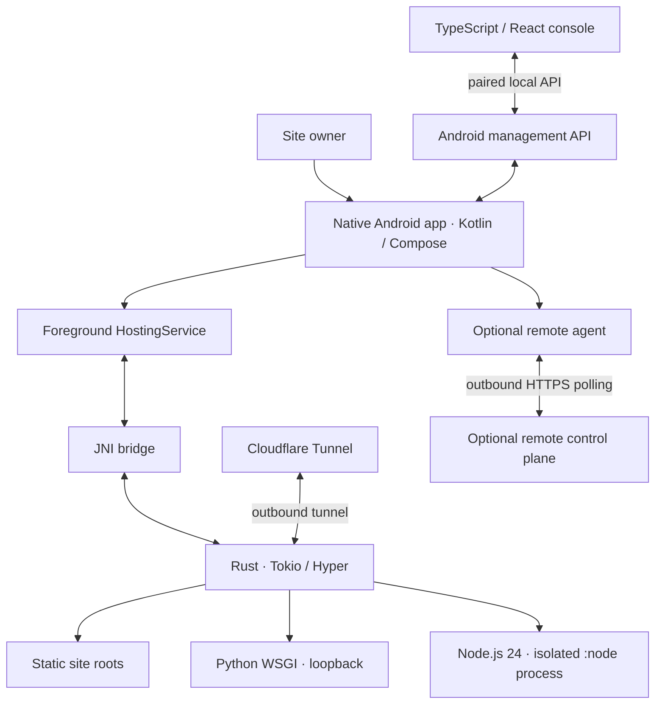

<!-- POCKETHOST · DESIGNED BY ASSAYFLUX -->
<p align="center">
  
</p>
<p align="center"><strong>Your website. Your device. Your control.</strong><br><sub>Designed by AssayFlux · Native Android hosting without Termux or root</sub></p>

<p align="center">
  <a href="https://github.com/AssayFlux/PocketHost/blob/main/LICENSE"></a>
  <a href="https://github.com/AssayFlux/PocketHost/actions/workflows/quality.yml"></a>
  <a href="https://github.com/AssayFlux/PocketHost/actions/workflows/android-integration.yml"></a>
</p>

**AssayFlux PocketHost** is a native Android application that turns a compatible smartphone into a compact website-hosting origin. The phone runs the website; Rust handles HTTP serving and routing; Kotlin manages Android lifecycle and controls; optional embedded Python and Node.js runtimes run trusted application code. A browser console provides local device management, while an optional remote control plane supports management when the phone is away.

> **Project status: integrated development build — not yet production approved.** Source components are present and the quality workflow has passed on the current implementation batch. Emulator execution, physical-device acceptance, external hostname verification and the production security review remain release gates. See [the live status record](docs/PHASE_0_STATUS.md).

## Product goals

- Standalone Android app. No Termux, root, or traditional web-hosting subscription required for the phone's hosting role.
- Android 8.0 (API 26)+ baseline and 4 GB RAM target.
- ARMv7 and ARM64 phone architectures; x86_64 emulator support.
- Static website hosting first, with optional Python WSGI and Node.js application runtimes.
- Simple and Advanced operating modes.
- Rust-based HTTP engine, multi-host routing and reverse proxy.
- Local TypeScript/React management console and authenticated pairing.
- Optional remote management through an independently deployed control-plane service.
- Cloudflare Tunnel for outbound public connectivity.

A phone is not a dedicated server. Battery, heat, mobile-network conditions, Android Doze, vendor process management, memory pressure and storage availability can interrupt hosting. PocketHost does not promise unlimited traffic or guaranteed 24/7 uptime.

## Architecture



| Layer | Implementation | Responsibility |
|---|---|---|
| Android app | Kotlin, Jetpack Compose | UI, storage access, permissions, lifecycle and notifications |
| Hosting engine | Rust, Tokio, Hyper | Static HTTP, hostname routing, reverse proxy and engine metrics |
| Native bridge | JNI | Coarse-grained Kotlin/Rust control |
| Python | CPython 3.11 via Chaquopy | Trusted WSGI application; one active app |
| Node.js | Node.js 24.22.1 mobile SDK | Trusted bundled app in a dedicated Android process |
| Local console | TypeScript, React, Vite | Authenticated local device management |
| Public connectivity | cloudflared Android-targeted build | Outbound connection from phone to Cloudflare edge |
| Remote management | Rust/Axum + PostgreSQL | Optional device registry, command queue, team roles and audit history |

The phone remains the website origin. The remote control plane is a separate optional management service; it does **not** serve the websites and is not required for local hosting or the phone's Cloudflare Tunnel connection.

## Current capabilities in source

| Area | Source implementation | Important boundary |
|---|---|---|
| Static hosting | Rust HTTP server, GET/HEAD, streaming, ranges, MIME, canonicalized paths | Physical-device performance and security testing remain |
| Multi-site | Hostname registry and static/Python/Node route selection | Node supports one active project/process |
| Python | Embedded CPython 3.11 WSGI, bounded worker pool and metrics | Root `wsgi.py`; no automatic pip install; trusted code only |
| Node.js | Pinned Node 24.22.1 mobile SDK, JNI bridge, dedicated `:node` process, supervisor and metrics | Prebundle dependencies; no normal child-process/npm-install workflow |
| Site deployment | SAF folder/ZIP import, validation, staged releases and rollback | Archive and upgrade edge cases need full acceptance |
| Local management | Pairing challenge, session bearer auth, site/runtime/tunnel/resource/log/metrics endpoints | Sessions are in-memory and expire after 12 hours |
| Browser console | TypeScript/React console backed by the local API | Must be served from an allowed origin and paired by the owner |
| Cloudflare | Android-targeted cloudflared builds, encrypted token storage and reconnect lifecycle | Tunnel process state is not proof that the public hostname serves correctly |
| Backups | Passphrase-protected encrypted static-site backup | Does not include Python/Node projects, settings or deployment history |
| Diagnostics | User-exported redacted logs and device diagnostics | Review bundle before sharing |
| Remote management | Optional Rust/PostgreSQL control plane, outbound phone agent, queued commands, device registry, team roles and audit events | Requires a separately reachable API deployment; not the website origin |

### Operating modes

- **Simple Mode:** guided static-site import, preview, hosting start/stop and tunnel controls.
- **Advanced Mode:** site/hostname configuration, Python and Node projects, resource limits, logs, diagnostics, backup/restore and optional remote-control pairing.

## Domain and Cloudflare

PocketHost supports a Cloudflare-managed named tunnel. If you already created the tunnel, connected the domain and configured its Public Hostname, **reuse that setup**; do not create a duplicate tunnel merely to follow generic setup instructions.

The Android app still needs the corresponding connector token configured securely in its Tunnel settings. The hostname's origin must point to the PocketHost Rust listener, not to the management API. Confirm the exact origin/port in your Cloudflare Public Hostname rule. For private content, configure Cloudflare Access; tunnel encryption is not visitor authentication.

A configured tunnel, a connected tunnel process and a publicly verified website are three different states. Production acceptance requires a request from an external network to return the expected site content over valid HTTPS. See [Cloudflare Tunnel guide](docs/CLOUDFLARE_TUNNEL.md).

## Compatibility and resource boundaries

- Minimum Android API: 26 (Android 8.0).
- Intended baseline: 4 GB RAM.
- Native ABIs: `armeabi-v7a`, `arm64-v8a`, and `x86_64` for emulator testing.
- Python WSGI worker setting: 2–16.
- Node V8 old-space setting: 96–512 MiB.
- These runtime settings are not hard OS memory/CPU quotas. Android may terminate processes under pressure.
- Python and Node projects execute with PocketHost's application UID. Neither runtime is a hostile-code sandbox or multi-tenant isolation boundary.
- Node projects must arrive with dependencies bundled. Native addons must match Android ABI and Node ABI.
- LAN mode is an explicit exposure choice and has no visitor authentication.

## Validation snapshot

The quality workflow on the current implementation batch passed its Rust, control-plane/PostgreSQL, Python, Node preload, TypeScript console and Android source-compilation jobs. The Android integration run associated with the same implementation batch has successfully built cloudflared but its ABI APK and API 26/33/35 emulator jobs were still running/queued at the last status check. Do not interpret a queued or running job as a pass.

- [Quality workflow](https://github.com/AssayFlux/PocketHost/actions/workflows/quality.yml)
- [Android integration workflow](https://github.com/AssayFlux/PocketHost/actions/workflows/android-integration.yml)
- [Detailed status and remaining gates](docs/PHASE_0_STATUS.md)
- [Device and production acceptance checklist](docs/REMOTE_CONTROL_ACCEPTANCE.md)

## Documentation

| Document | Purpose |
|---|---|
| [North Star](docs/NORTH_STAR.md) | Product goals and non-goals |
| [Master engineering plan](docs/MASTER_PLAN.md) | Architecture and implementation direction |
| [Implementation status](docs/PHASE_0_STATUS.md) | Source truth, CI evidence and unverified items |
| [Completion milestone](docs/COMPLETION_MILESTONE.md) | Remaining work and definition of done |
| [Cloudflare Tunnel](docs/CLOUDFLARE_TUNNEL.md) | Reusing a named tunnel and public-hostname checks |
| [Python runtime](docs/PYTHON_RUNTIME.md) | WSGI project contract and limitations |
| [Node runtime](docs/NODE_RUNTIME.md) | SDK provenance, integration and limitations |
| [Site backup](docs/SITE_BACKUP.md) | Backup format and restore boundaries |
| [Remote control acceptance](docs/REMOTE_CONTROL_ACCEPTANCE.md) | Backend, phone and end-to-end acceptance |
| [Control-plane deployment](docs/CONTROL_PLANE_DEPLOYMENT.md) | Optional independent management backend |
| [Release signing](docs/RELEASE_SIGNING.md) | Secure APK signing |

## Build overview

A clean native build requires JDK 17, Android SDK 35, NDK 27.2.12479018, CMake 3.22.1, Rust stable with Android targets, `cargo-ndk`, Go 1.27.4 for cloudflared and network access to retrieve the pinned Node mobile SDK. The console requires Node.js/npm.

Source compilation without assembling APKs:

```bash
gradle :app:externalNativeBuildDebug :app:compileDebugKotlin :app:compileDebugAndroidTestKotlin
```

Full ABI APK packaging and emulator instrumentation are handled by [Android integration CI](.github/workflows/android-integration.yml). Signed release builds require the secrets described in [release signing](docs/RELEASE_SIGNING.md).

## Security disclosure

Do not expose the local management API to the public internet. Do not import code you do not trust. Do not treat LAN mode or a public tunnel as an authentication layer. Never commit tunnel tokens, remote-control tokens, database credentials, SSH keys, signing keys or generated `.env` files. The separate control plane has its own deployment and security requirements.

## License

See [LICENSE](LICENSE) and the third-party notices bundled under `app/src/main/assets/licenses/`.
