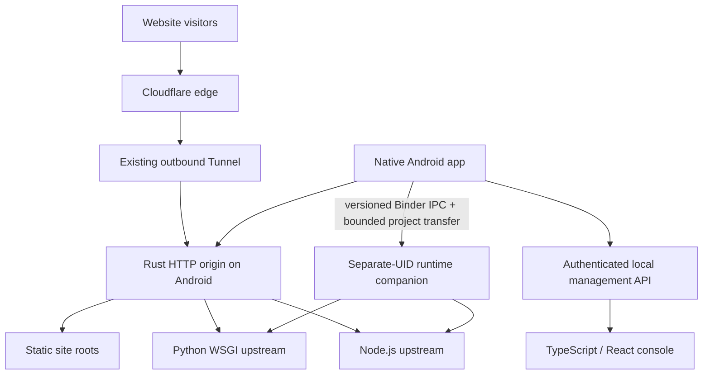

<!-- ASSAYFLUX POCKET HOST · ENGINEERING BASELINE -->

  

  <strong>YOUR PHONE. YOUR WEBSITE ORIGIN.</strong> 
  A native Android website host for small sites, development and modest workloads.

  
  
  
  
  
  

  
  
  
  

> **Companion integration source snapshot · 16 November 2026:** `bd227b0e5564ad25c88064cfc36796469390b773`  
> **Estimated overall engineering readiness: 37%.** This is a weighted milestone assessment, not a test-coverage metric or a claim of production readiness. The native app, static Rust origin, local management and operations foundations exist. Python and Node have now been moved into the separate-UID companion in source; build and API-matrix verification are pending. The previous 37% readiness score is retained until that evidence is available. See [the single current baseline](docs/PROJECT_BASELINE.md).

---

## THE PROJECT

AssayFlux Pocket Host turns an Android phone into a self-hosted website origin. The phone serves static websites through a Rust HTTP engine and can route owner-installed Python WSGI and Node.js applications. An existing Cloudflare Tunnel can expose the website without opening an inbound router port.

**No Termux. No root. No mandatory VPS.** Static hosting must remain usable when optional runtimes or remote management are stopped.

<table>
<tr>
<td align="center" width="33%"><strong>PHONE-FIRST</strong> Android 8+, ARMv7 and ARM64 design target, including budget devices.</td>
<td align="center" width="33%"><strong>OWNER-CONTROLLED</strong> Local management, owner/operator roles and explicit runtime trust.</td>
<td align="center" width="33%"><strong>EVIDENCE-LED</strong> Builds, tests, security boundaries and external acceptance are reported separately.</td>
</tr>
</table>

## CURRENT SOFTWARE SCOPE

| AREA | IMPLEMENTED FOUNDATION |
|---|---|
| Android app | Kotlin, Jetpack Compose, five destinations, foreground hosting service |
| Website origin | Rust, Tokio and Hyper; hostname routing, static files, streaming and byte ranges |
| Static deployment | Folder/ZIP import, staged deployment, file management and rollback |
| Python | CPython 3.11 / WSGI in separate-UID companion; trusted owner-installed code only |
| Node.js | Pinned Node.js 24 mobile runtime in separate-UID companion; trusted owner-installed code only |
| Management | Authenticated loopback API and TypeScript/React console |
| Edge connectivity | Android cloudflared connector; use the owner's existing named tunnel |
| Operations | Device/resource metrics, activity logs, diagnostics and initial Capacity Lab |
| Backup | Passphrase-encrypted backup/restore with device-bound credentials excluded |
| Companion | Separate package/UID; signature-protected versioned Binder IPC, bounded project transfer, Python and Node runtime source integration |

## ARCHITECTURE

The public hostname must route to the Rust website listener. It must **never** route to the management API. Python and Node now execute under the companion package UID in the migrated source. This separates them from host-app-private files, but does not isolate sites from one another or enforce network egress. The companion migration is not verified until its build and API 26/33/35 instrumentation pass.

## RELEASE READINESS

<strong>Weighted engineering readiness — 37 / 100</strong>

| RELEASE SEQUENCE | WEIGHT | CURRENT ESTIMATE |
|---|---:|---:|
| Companion runtime migration | 25% | 15% |
| Isolation and adversarial security | 20% | 25% |
| Rust governor and Capacity Lab | 15% | 60% |
| Backup, operations and Settings | 15% | 65% |
| API 26/33/35 CI and APK evidence | 15% | 55% |
| Signing, external HTTPS and review | 10% | 15% |
| **Weighted total** | **100%** | **37%** |

These percentages are engineering estimates against acceptance criteria. They are not LOC completion, test coverage or a substitute for release approval. Exact gates and evidence are in [PROJECT_BASELINE.md](docs/PROJECT_BASELINE.md).

## VERIFIED CI SNAPSHOT

- [Quality workflow 43789396734](https://github.com/AssayFlux/PocketHost/actions/runs/43789396734): all six jobs passed.
- [Android integration workflow 43789396568](https://github.com/AssayFlux/PocketHost/actions/runs/43789396568): API 26 passed 31 instrumentation tests with zero failures; APK packaging and cloudflared Android build passed. API 33 was still running and API 35 queued at the last check.
- Debug APK packaging is not a signed production release. The previous artifact download attempt was truncated; do not use that archive.

## BUILD

Open the repository in Android Studio or use the Gradle wrapper in an Android SDK environment. Build both `:runtime-worker:assembleDebug` and `:app:assembleDebug`. Install the matching `pockethost-runtime-worker` APK first, then the ABI-specific host APK; both must be signed with the same certificate. The Android workflow packages the pair together. Production signing is intentionally gated on owner-controlled GitHub Actions secrets; see [RELEASE_SIGNING.md](docs/RELEASE_SIGNING.md).

## PRODUCT BOUNDARIES

- Supported target: small websites, development and modest workloads on a phone.
- Not a cloud-region replacement or an uptime guarantee.
- Python and Node are for trusted owner-installed code only. The companion UID separates runtime code from host-private files, but per-project isolation and enforceable network egress remain incomplete and require adversarial review.
- No hard CPU quota is claimed for ordinary Android app processes.
- Physical device lifecycle/thermal/battery acceptance and external Cloudflare HTTPS verification are not inferred from emulator or connector builds.

## ENGINEERING DOCUMENTS

| DOCUMENT | PURPOSE |
|---|---|
| [Project baseline](docs/PROJECT_BASELINE.md) | Canonical scope, weighted readiness, six gates and evidence |
| [Roadmap](docs/ROADMAP.md) | Only the active release sequence |
| [Phase status](docs/PHASE_0_STATUS.md) | Implemented behavior and explicit limitations |
| [Completion milestone](docs/COMPLETION_MILESTONE.md) | Acceptance criteria for release completion |
| [Development context](docs/DEVELOPMENT_CONTEXT.md) | Architecture and constraints for contributors |
| [Release signing](docs/RELEASE_SIGNING.md) | Secure owner-controlled release signing |
| [Runtime companion](docs/RUNTIME_COMPANION.md) | Separate UID, IPC, project transfer, APK pairing and security limits |

**Maintained by AssayFlux.** The code and evidence—not a badge, plan or percentage—determine release readiness.
