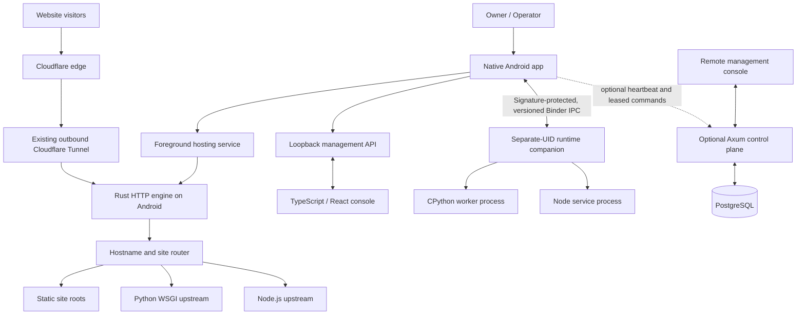

<p align="center">
  
</p>
<h1 align="center">AssayFlux Pocket Host</h1>
<p align="center">
  <strong>Turn an Android phone into a website origin.</strong><br>
  Static hosting, optional Python and Node application runtimes, a native control surface and an optional remote-management plane.
</p>
<p align="center">
  
  
  
  
  
  
</p>
<p align="center">
  <a href="https://github.com/AssayFlux/PocketHost/actions/workflows/quality.yml"></a>
  <a href="https://github.com/AssayFlux/PocketHost/commits/main"></a>
  <a href="https://github.com/AssayFlux/PocketHost/issues"></a>
  <a href="https://github.com/AssayFlux/PocketHost/blob/main/LICENSE"></a>
</p>

> **Engineering status — 16 November 2026**  
> Companion runtime migration source is integrated on `main`; the migrated build and API 26/33/35 verification are pending. The last verified weighted readiness estimate remains **37%** until that evidence is available. This is not a production release. See [Project Status](docs/PROJECT_STATUS_2026-11-16.md) and the [canonical Project Baseline](docs/PROJECT_BASELINE.md).

---

## Contents

- [What Pocket Host is](#what-pocket-host-is)
- [Capabilities at a glance](#capabilities-at-a-glance)
- [System architecture](#system-architecture)
- [Request and control flows](#request-and-control-flows)
- [Android application](#android-application)
- [Rust website engine](#rust-website-engine)
- [Python and Node runtimes](#python-and-node-runtimes)
- [Management API and console](#management-api-and-console)
- [Optional remote control plane](#optional-remote-control-plane)
- [Cloudflare Tunnel and public access](#cloudflare-tunnel-and-public-access)
- [Adaptive capacity and device protection](#adaptive-capacity-and-device-protection)
- [Sites, deployment and file management](#sites-deployment-and-file-management)
- [Backup, logs and operational reporting](#backup-logs-and-operational-reporting)
- [Security model and limitations](#security-model-and-limitations)
- [Security Gate 2 Execution Plan](docs/SECURITY_GATE_2_EXECUTION_PLAN.md)
- [Build from source](#build-from-source)
- [CI and verification](#ci-and-verification)
- [Repository map](#repository-map)
- [Documentation](#documentation)
- [Roadmap and release criteria](#roadmap-and-release-criteria)

## What Pocket Host is

AssayFlux Pocket Host is a native Android application that makes the phone itself the website origin. The Rust engine accepts website traffic, selects a site by hostname and serves static content or reverse-proxies to a trusted local application runtime. An existing outbound Cloudflare Tunnel can make the website reachable through a public hostname without opening an inbound router port.

The project targets Android 8.0 (API 26) and newer, ARMv7 and ARM64 phones, with x86_64 used for emulator/build coverage. The design goal includes affordable devices with around 4 GB RAM. These are compatibility targets, not a claim that every device or workload has already passed physical-device acceptance.

**No Termux. No root. No mandatory VPS for core hosting.** Static websites are the independent baseline. Python, Node and remote management are optional capabilities.

### Product modes

| Mode | Intended use | Capabilities |
|---|---|---|
| **Simple** | Publish a static website from a phone | Import a folder/ZIP, preview locally, start/stop hosting, connect the existing tunnel, inspect activity and restore a backup |
| **Advanced** | Operate multiple sites and trusted application backends | Hostname routing, Python WSGI, Node.js, resource settings, capacity profiles, diagnostics and optional remote management |

Pocket Host is intended for small websites, development and modest workloads. It is not a cloud-region replacement, object-storage service or uptime guarantee.

## Capabilities at a glance

| Subsystem | Technology | Current implementation status |
|---|---|---|
| Native Android app | Kotlin, Jetpack Compose, Android services | Five-destination app foundation; device acceptance remains |
| Website HTTP engine | Rust, Tokio, Hyper, JNI | Static serving, hostname routing, reverse proxy, admission controls and metrics |
| Static site lifecycle | Kotlin storage + Rust serving | Folder/ZIP import, staged activation, file operations and SPA fallback |
| Python application hosting | CPython 3.11, Chaquopy, WSGI | Source moved into separate-UID companion; migrated build/API matrix pending |
| Node application hosting | Node.js mobile 24.22.1, JNI/C++ | Source moved into separate-UID companion; migrated build/API matrix pending |
| Runtime IPC | Android Binder, signature permission | Versioned host/companion protocol and bounded project transfer in source |
| Local management | Kotlin loopback API | Pairing, expiring bearer sessions, role-aware routes and operational endpoints |
| Browser console | TypeScript, React 18, Vite 6 | Local management console and account/capacity/site workflows |
| Edge connector | Cloudflare Tunnel / cloudflared | Android-targeted connector build; external hostname verification remains |
| Device protection | Android telemetry + Rust admission controls | First-pass adaptive derating and bounded capacity test; full governor remains |
| Backup | AES-256-GCM encrypted `.afbackup` | Static and runtime project/route backup source; restore fault matrix remains |
| Remote management | Rust, Axum, PostgreSQL, SQLx | Optional backend/agent source; deployment and real-device end-to-end verification remain |

---

## System architecture

The phone remains the website origin. Kotlin owns Android lifecycle and device integration; Rust owns the HTTP request path; the TypeScript console is a management client, not a second website server.



### Technology stack

| Layer | Main technologies | Responsibility |
|---|---|---|
| Android UI and lifecycle | Kotlin, Jetpack Compose, AndroidX, foreground services, Storage Access Framework | Screens, permissions, local files, notifications, device telemetry and process supervision |
| HTTP engine | Rust 2021, Tokio 1.43, tokio-util 0.7, Hyper 1.5, hyper-util 0.1, JNI 0.21 | Async listener, HTTP parsing/serving, hostname routing, proxying, admission and metrics |
| Python runtime | Chaquopy, CPython 3.11 | Embedded WSGI applications in the companion package |
| Node runtime | Node.js mobile 24.22.1, C++20, JNI, CMake | Embedded Node server in the companion's dedicated process |
| Runtime control | Android Binder, ParcelFileDescriptor, package/signature validation | Host-to-companion commands and bounded project transfer |
| Browser console | TypeScript 5.7, React 18, Vite 6 | Authenticated browser-based management |
| Remote control plane | Rust, Axum 0.7, Tokio, SQLx 0.8, PostgreSQL 16 | Optional remote device registry, heartbeat, configuration and leased commands |
| Public connectivity | Cloudflare Tunnel / cloudflared | Outbound tunnel from phone to Cloudflare |

## Request and control flows

### Website request

1. A visitor resolves the configured public hostname.
2. Cloudflare receives the request and forwards it through the owner's existing named tunnel.
3. cloudflared on Android forwards to the Rust website listener.
4. Rust validates the hostname, selects its registered site target and applies admission/rate controls.
5. Rust serves a static file or proxies the request to a loopback Python/Node upstream.
6. The response returns through Rust and the tunnel.

The public hostname must target the Rust website listener. It must **never** target the management API.

### Local administration

1. The browser requests a short-lived pairing challenge from the loopback management API.
2. The owner approves the six-digit code inside the Android app.
3. The browser receives an expiring bearer session.
4. The console uses that session for site, runtime, capacity, telemetry, logs and tunnel operations.
5. Owner-only account/resource actions are authorized separately from Operator permissions.

The management API is loopback-only by design and is not part of the public website request path.

### Companion runtime control

The main app and companion are separately installed Android packages with different application UIDs:

- Host package: `com.assayflux.pockethost`
- Companion package: `com.assayflux.pockethost.worker`

The host transfers a bounded project archive through a file descriptor over signature-protected Binder IPC. The companion validates and extracts it into companion-owned private storage. Python and Node then execute under the companion UID, not the host app UID. The two runtime processes share the companion package UID.

This migration is integrated in source; the migrated build and emulator matrix are not yet verified. See [Runtime Companion](docs/RUNTIME_COMPANION.md).

## Android application

### Navigation

The native application uses five primary destinations:

- **Dashboard** — hosting state, Start/Stop, local/public URLs, traffic summary, device health and capacity.
- **Sites** — registered websites, imported content, project roots and runtime configuration.
- **Activity** — redacted operational events, filtering, search and diagnostics.
- **Learn** — guided setup and explanations of hosting, deployment and operational concepts.
- **Settings** — hosting preferences, tunnel configuration, capacity, backup, accounts and application information.

The approved UI system uses a light default theme with optional dark mode, a navy accent, restrained cards, accessible tap targets and responsive layouts. The UI specification is [UI_DESIGN.md](docs/UI_DESIGN.md). Screen-size, keyboard, landscape and physical-device acceptance are not claimed complete.

### Android responsibilities

- Foreground hosting service and visible notification controls.
- Rust engine lifecycle and runtime/tunnel supervision.
- Website folder selection and ZIP import.
- Local file management and in-app website preview.
- Device profile, memory, storage, battery and thermal telemetry.
- Owner/Operator account state and biometric app-launch unlock.
- Encrypted local backup and restore.
- Optional remote-control agent while hosting service is active.

## Rust website engine

The Rust crate is located in `rust-engine/` and builds as an Android native library through JNI.

### Async runtime and HTTP stack

Pocket Host uses **Tokio** as its asynchronous runtime:

- `tokio` multi-thread runtime, networking, synchronization, macros, timers and filesystem features.
- `tokio-util` asynchronous I/O helpers, including streamed file responses.
- `hyper` HTTP/1 server primitives.
- `hyper-util` Tokio integration, server connection handling and HTTP client connector.
- `futures-util` stream composition.
- `jni` for the Kotlin/Rust lifecycle and configuration boundary.

### Website engine responsibilities

- HTTP listener and hostname-to-site target table.
- Static file delivery with MIME handling and streamed file bodies.
- GET/HEAD support, byte-range responses and SPA fallback for extensionless routes.
- Canonical path validation and rejection of traversal/invalid paths.
- Reverse proxying to loopback application ports.
- Hop-by-hop header stripping and forwarded host/protocol metadata.
- Bounded global and per-site connection admission.
- Bounded connection waiting and overload responses with `503 Retry-After`.
- Per-client token-bucket request-rate controls with bounded tracking.
- Graceful engine stop/drain and atomic request/byte/connection counters.

Current engine constants include a 16-connection global ceiling, 32 queued connections, a 200 ms queue wait, a 3-second shutdown drain, a 50 MiB per-file serving cap and bounded per-client rate buckets. These are implementation limits, not a benchmarked visitor guarantee. The full source is in [rust-engine/src/lib.rs](rust-engine/src/lib.rs).

The first-pass Android health controller can reduce the effective admission ceiling and suspend optional runtimes when device health becomes critical. A complete Rust-native fair scheduler, per-site rate policy, circuit breakers and sustained-load acceptance remain open work.

## Python and Node runtimes

Both runtimes are optional and currently intended for **trusted, owner-controlled code only**.

### Python WSGI

- CPython 3.11 via Chaquopy in the companion APK.
- Root-level `wsgi.py` exporting a callable named `application`.
- Hostname routing to a WSGI worker; current source supports up to 100 registered hostnames.
- Configurable worker concurrency from 2 to 16.
- Rust remains the public/LAN ingress and proxies to the Python loopback listener.
- No automatic `pip install`; prepare compatible dependencies before importing.
- No ASGI or WebSocket support in the current runtime.

Example:

```python
def application(environ, start_response):
    body = b"Hello from AssayFlux Pocket Host"
    start_response("200 OK", [
        ("Content-Type", "text/plain; charset=utf-8"),
        ("Content-Length", str(len(body))),
    ])
    return [body]
```

See [Python Runtime](docs/PYTHON_RUNTIME.md) and [the example WSGI project](examples/python-wsgi/).

### Node.js

- Pinned Node.js mobile SDK release `v24.22.1-0`, based on Node.js 24.22.1.
- Native `libnode.so` and Pocket Host JNI bridge packaged in the companion APK for `arm64-v8a`, `armeabi-v7a` and `x86_64`.
- Dedicated companion `:node` Android process.
- One active embedded Node application at a time.
- Dependencies must be prebundled in the imported project.
- No on-device `npm install`, PM2/cluster or general desktop `child_process` workflow.
- V8 heap configuration is an application-level heap setting, not a hard total-RSS or CPU quota.

See [Node Runtime](docs/NODE_RUNTIME.md).

### Runtime isolation boundary

The companion UID protects host-app-private files from ordinary runtime code. It does **not** isolate one project from another project stored by the companion, and outbound network egress is not yet constrained by an enforceable firewall. Loopback management services also require their own authentication.

Do not run arbitrary third-party code or market this as a hostile-code/multi-tenant sandbox. Per-project filesystem isolation, network-egress enforcement and adversarial testing are release-blocking security work.

## Management API and console

### Local management API

The device API listens on `127.0.0.1:17841` and is described by [OpenAPI 3.1](docs/management-api-v1.yaml).

Current endpoint groups include:

| Endpoint group | Operations |
|---|---|
| Health and pairing | Health, short-lived pairing challenge and on-device approval |
| Sessions and accounts | Session revocation, password change, Owner recovery, Owner/Operator management |
| Hosting status | Android service and runtime state |
| Sites | List, create/update hostname mappings, remove sites, start/stop runtime actions |
| Resources | Read/set bounded Python worker and Node heap settings |
| Telemetry and capacity | Device samples, admission budget, capacity profiles and benchmark state/start |
| Operations | Reports, runtime-attributed metrics and redacted logs |
| Tunnel | Read connector state and start/stop the configured connector |

The API uses expiring bearer sessions and route-level role checks. Pairing approval is performed on the phone; it is not an anonymous public sign-up endpoint. Backups and diagnostics-file transfer remain native user-mediated operations rather than public management API routes.

### Browser console

The console is in `web-console/` and is built with TypeScript, React and Vite. It provides browser-based management for pairing/sign-in, sites, device status, capacity, telemetry and operations. It is a management client for the phone API; it does not host visitor websites.

Build the console:

```sh
cd web-console
npm install
npm run build
```

## Optional remote control plane

The remote control plane is a separate Rust/Axum service with PostgreSQL. It is **optional** and is not the phone's website server. Core local hosting and the phone's Cloudflare Tunnel do not depend on it.

Source capabilities include:

- Owner-managed device registration and revocation.
- Device-token authentication and heartbeat reporting.
- Versioned desired configuration.
- Allowlisted command queue with lease and expiry.
- Device command acknowledgements and interrupted-action reporting.
- Website ZIP deployment with SHA-256 verification.
- Editor/Viewer remote roles and audit event retrieval.
- Exact-origin CORS policy.

The backend uses SQLx migrations and PostgreSQL. Docker Compose deployment is documented in [Control Plane Deployment](docs/CONTROL_PLANE_DEPLOYMENT.md). A live deployment, external TLS, real-phone pairing and command-recovery acceptance are not inferred from source or CI. The remote plane cannot execute arbitrary shell commands on the phone and does not serve the public website.

## Cloudflare Tunnel and public access

Pocket Host includes an Android-targeted cloudflared build from the pinned upstream source tag `2026.11.0`, for ARM64, ARMv7 and x86_64. The connector runs as an outbound tunnel and stores its token encrypted with an Android Keystore-backed AES-GCM key.

**Use the owner's existing named tunnel and hostname. Do not create a duplicate tunnel.**

In Cloudflare, configure the website Public Hostname to point to the phone's Rust website listener. Never point it at port `17841` or any management API. A configured token, a running connector and externally verified HTTPS are three different states. Only a request from an independent network that returns the intended website over valid TLS proves public reachability.

Cloudflare Tunnel is not visitor authentication. Use Cloudflare Access for private sites. See [Cloudflare Tunnel on Android](docs/CLOUDFLARE_TUNNEL.md).

## Adaptive capacity and device protection

The project measures device conditions and applies a first-pass safety policy. Current source includes:

- Device profile and versioned telemetry snapshots: CPU load, memory/PSS, storage, battery, temperature, thermal status and network information where Android exposes it.
- A bounded history of telemetry samples.
- Capacity Lab static GET sweep at controlled concurrency steps.
- Conservative initial concurrency ceiling before calibration.
- NORMAL, CONSTRAINED, PROTECTIVE, RECOVERY and EMERGENCY health states.
- Admission derating as CPU, memory, storage or thermal conditions worsen.
- Optional Python/Node suspension under protective/emergency conditions.
- Rust connection limits, bounded queue and overload responses.
- Capacity percentage profiles and timed overrides.

The current Capacity Lab does not yet represent every real workload: cached/uncached payload classes, Python/Node throughput, full p50/p95/p99 analysis and multi-hour thermal tests remain to be completed. Capacity percentage is a share of a safe admission budget, not CPU utilization or a guaranteed visitor count.

The complete acceptance requirements are in [Adaptive Capacity, Security, Payments and Operations](docs/ADAPTIVE_CAPACITY_SECURITY_OPERATIONS.md).

## Sites, deployment and file management

### Static websites

Pocket Host hosts built website output. Build your frontend with its normal toolchain, then import the generated directory or a ZIP containing its contents.

| Website source | What to import |
|---|---|
| Plain HTML/CSS/JS | Directory containing root `index.html` |
| TypeScript | Browser bundle/build output, not raw TypeScript source |
| React/Vue/Svelte/Angular | Framework production build output |
| Vite | Usually `dist/` |
| Next.js | Static export output such as `out/`; not a Next.js server |
| Python | Project with root `wsgi.py` exporting `application` |
| Node.js | Self-contained project with `package.json`, server entry and prebundled dependencies |

The static file manager supports website import, upload, create, rename, edit for text files, delete and preview. Static serving includes SPA fallback for extensionless client routes. Missing asset paths with file extensions remain 404. See [Website Deployment](docs/WEBSITE_DEPLOYMENT.md).

### Import and activation

Imported content is validated and staged before activation. Archive handling enforces path and size rules; site deployment uses separate roots and rollback-aware activation. Do not upload credentials, private keys or environment files into public website directories.

## Backup, logs and operational reporting

### Encrypted backup

The native backup format is `.afbackup` with the `AFPHB02\n` format identifier. It uses AES-256-GCM authenticated encryption, a random salt/nonce and PBKDF2-HMAC-SHA-256 key derivation. The passphrase is not stored.

The current backup source includes static website files, optional Python/Node project roots, hostname routes and an allowlist of non-secret settings. Tunnel tokens, remote credentials, Owner/Operator accounts, session tokens and Android Keystore keys are excluded and must be configured separately on a replacement device. Restored runtimes do not start automatically.

Backup/restore requires runtimes and static hosting to be stopped and enforces archive, file-count and size limits. See [Site Backup](docs/SITE_BACKUP.md).

### Activity and reports

The app stores bounded, redacted operational events and aggregate daily reports. Metrics include Rust engine request/byte/connection counters and available device/runtime information. Reporting is not yet a complete durable analytics or financial reconciliation system; latency distributions, full network/tunnel availability history and tamper-evident audit remain open work.

## Security model and limitations

Security boundaries are explicit; a feature is not a security control merely because it has a UI setting.

- Public visitor traffic and management traffic use separate listeners and authentication boundaries.
- The local management API is loopback-only and requires pairing/session authentication.
- Owner and Operator permissions are enforced by the device API; account material is protected with app-private encrypted storage and Android Keystore.
- Cloudflare tunnel tokens are encrypted at rest and must never appear in logs or source.
- Imported archives are bounded and path-validated; deployment/restore use staging and rollback protections.
- The companion UID protects host-private files, not sibling projects. Python multi-site code shares one interpreter; Python and Node projects share the companion UID.
- Python WSGI always binds to `127.0.0.1`; Node's preload constrains ordinary TCP server listeners to loopback. These are ingress controls, **not** outbound-network restrictions.
- The companion currently has Android `INTERNET` permission. Raw sockets, DNS-based bypasses, private/link-local destinations and loopback management reachability are not blocked by an OS-enforced per-project policy.
- Python/Node therefore remain owner-trusted-code-only. Do not execute visitor-submitted, marketplace or otherwise untrusted project code. The Step 2 target architecture and adversarial acceptance plan are in [Security Isolation Design](docs/SECURITY_ISOLATION_DESIGN.md).
- Android foreground services cannot guarantee uninterrupted 24/7 hosting.
- No hard CPU quota or cloud-style uptime guarantee is claimed.
- No live payment processing or PCI approval is claimed.

Read [Runtime Companion](docs/RUNTIME_COMPANION.md), [Development Context](docs/DEVELOPMENT_CONTEXT.md) and [Completion Milestone](docs/COMPLETION_MILESTONE.md) before changing security-sensitive code.

## Build from source

### Requirements

- JDK 17.
- Android SDK Platform 35 and Android Build Tools 35.
- Android NDK 27.2.12479018.
- CMake 3.22.1.
- Rust stable toolchain and Android targets for `aarch64-linux-android`, `armv7-linux-androideabi` and `x86_64-linux-android`.
- `cargo-ndk`.
- Python 3.11 for the quality/runtime checks.
- Node.js 22 for the console build and Node.js 24 for Node preload tests.
- Gradle 8.9 as used by the CI workflows.

### Android packages

The host app and runtime companion are separate APKs and must be built and installed as a matching pair. They must be signed with the same certificate.

```sh
# Build the runtime companion (includes Chaquopy and pinned Node mobile SDK)
gradle :runtime-worker:assembleDebug

# Build the host app for all configured ABIs
gradle :app:assembleDebug

# Build one host ABI at a time
gradle :app:assembleDebug -PpockethostAbi=arm64-v8a
gradle :app:assembleDebug -PpockethostAbi=armeabi-v7a
gradle :app:assembleDebug -PpockethostAbi=x86_64
```

The supported host ABIs are ARM64, ARMv7 and x86_64. The companion packages the matching Node native libraries for all three ABIs. Install the companion APK and the corresponding host APK from the same build/signing set. Debug builds are for development and integration testing, not public production distribution.

### Release signing

Set these environment variables in a protected release environment:

- `POCKETHOST_KEYSTORE_FILE`
- `POCKETHOST_KEYSTORE_PASSWORD`
- `POCKETHOST_KEY_ALIAS`
- `POCKETHOST_KEY_PASSWORD`

Never commit the keystore or expose signing credentials. See [Release Signing](docs/RELEASE_SIGNING.md).

## CI and verification

### Quality workflow

`.github/workflows/quality.yml` checks:

- Rust engine tests.
- Axum/PostgreSQL control-plane tests and migrations.
- Python syntax and WSGI lifecycle tests.
- Node metrics preload smoke tests.
- TypeScript type-check and Vite production build.
- Android Kotlin and instrumentation source compilation.

### Android integration workflow

`.github/workflows/android-integration.yml`:

- Builds pinned cloudflared for Android ABIs.
- Builds the companion APK and ABI-specific host APKs.
- Checks package IDs, API floor, native library contents and matching signing certificates.
- Runs Android instrumentation on API 26, 33 and 35.

Always use the run attached to the exact commit being evaluated. A green source-quality workflow is not proof that APK packaging, emulator tests, external HTTPS or physical-device tests passed. Historical workflow evidence and current migration status are recorded in [Project Status](docs/PROJECT_STATUS_2026-11-16.md).

## Repository map

```text
PocketHost/
├── app/                         # Native Android host app
│   └── src/
│       ├── main/                 # Compose UI, services, management, storage, tunnel
│       └── androidTest/          # Android instrumentation tests
├── runtime-worker/               # Separate-UID Python + Node companion APK
│   └── src/main/
│       ├── java/                 # Binder service, Python/Node lifecycle
│       ├── cpp/                  # Node JNI bridge
│       └── python/               # CPython WSGI runtime
├── rust-engine/                  # Tokio + Hyper website HTTP engine
├── web-console/                  # TypeScript + React + Vite management UI
├── control-plane/                # Optional Axum + PostgreSQL remote backend
├── examples/                     # Example hosted projects
├── tests/                        # Python and Node host-side smoke tests
├── scripts/                      # Native Android build helpers
├── docs/                         # Architecture, API, security and acceptance docs
└── .github/workflows/            # Quality, Android integration and deployment CI
```

## Documentation

| Document | What it covers |
|---|---|
| [North Star](docs/NORTH_STAR.md) | Product principles and non-negotiable boundaries |
| [Project Baseline](docs/PROJECT_BASELINE.md) | Canonical scope, readiness method and release gates |
| [Project Status](docs/PROJECT_STATUS_2026-11-16.md) | Current source integration, CI evidence and remaining gates |
| [Master Plan](docs/MASTER_PLAN.md) | Architecture, runtime contracts and engineering sequence |
| [Roadmap](docs/ROADMAP.md) | Ordered implementation work |
| [Runtime Companion](docs/RUNTIME_COMPANION.md) | Separate UID, Binder protocol, transfer and limitations |
| [Security Isolation Design](docs/SECURITY_ISOLATION_DESIGN.md) | Threat model, Android constraints, target boundary and adversarial acceptance |
| [Python Runtime](docs/PYTHON_RUNTIME.md) | WSGI requirements and runtime behavior |
| [Node Runtime](docs/NODE_RUNTIME.md) | Node mobile SDK, native build and restrictions |
| [Management API](docs/management-api-v1.yaml) | OpenAPI contract for local device API |
| [UI Design](docs/UI_DESIGN.md) | Native UI layout, palette and acceptance |
| [Learn Guide](docs/LEARN_GUIDE.md) | Quick start and user workflows |
| [Website Deployment](docs/WEBSITE_DEPLOYMENT.md) | Static frontend and backend deployment |
| [Cloudflare Tunnel](docs/CLOUDFLARE_TUNNEL.md) | Existing tunnel configuration and external verification |
| [Adaptive Capacity](docs/ADAPTIVE_CAPACITY_SECURITY_OPERATIONS.md) | Telemetry, capacity, security and operations |
| [Site Backup](docs/SITE_BACKUP.md) | Backup format, encryption, limits and recovery |
| [Remote Control Plane](docs/CONTROL_PLANE_DEPLOYMENT.md) | Optional backend deployment and pairing |
| [Release Signing](docs/RELEASE_SIGNING.md) | Owner-controlled signing procedure |
| [Completion Milestone](docs/COMPLETION_MILESTONE.md) | Production definition of done |

## Roadmap and release criteria

The active release sequence is:

1. Finish and verify companion runtime migration, lifecycle and Rust routing.
2. Complete per-project filesystem isolation, enforceable network egress and adversarial security tests.
3. Finish the Rust-native governor, fair scheduling and representative Capacity Lab.
4. Complete backup/restore fault coverage, operational reporting and Settings acceptance.
5. Pass full API 26/33/35 CI and physical ARMv7/ARM64 acceptance.
6. Verify the existing Cloudflare hostname externally, complete independent review and produce a signed release pair.

A release is not complete because the README is complete, a workflow is green or source files exist. Completion requires the same candidate commit to pass the required builds, automated tests, security gates, external connectivity checks and release-signing verification.

---

**AssayFlux Scientific Systems · Designed by AssayFlux**
