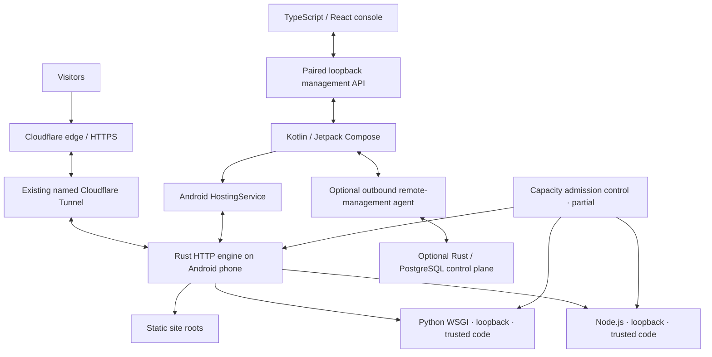

<!-- POCKETHOST · DESIGNED BY ASSAYFLUX -->
<p align="center">
  
</p>
<p align="center"><strong>Your website. Your device. Your control.</strong><br><sub>Designed by AssayFlux · Native Android hosting without Termux or root</sub></p>

<p align="center">
  <a href="https://github.com/AssayFlux/PocketHost/blob/main/LICENSE"></a>
  <a href="https://github.com/AssayFlux/PocketHost/actions/workflows/quality.yml"></a>
  <a href="https://github.com/AssayFlux/PocketHost/actions/workflows/android-integration.yml"></a>
</p>

**AssayFlux PocketHost** turns a compatible Android phone into a compact website origin. The phone hosts the website; Rust owns HTTP serving and routing; Kotlin manages Android lifecycle and native controls; TypeScript powers the management console. Optional Python and Node.js runtimes execute trusted application code. Cloudflare Tunnel provides outbound connectivity. An optional remote control plane manages devices but never replaces the phone as the website origin.

> **Status: integrated development build — not production approved.** The Android dashboard and TypeScript console now include a device-specific static-workload Capacity Lab, calibrated connection-admission budget, temporary capacity schedules, explicit HTTP 503 overload rejection and daily aggregate operations reports. These are bounded first implementations, not a complete adaptive governor or a universal capacity guarantee. Physical-device, public-domain, runtime-isolation and independent security gates remain. See [current status](docs/PHASE_0_STATUS.md).

## North Star

Make reliable, transparent and affordable self-hosting accessible to people with limited budgets or no need for large cloud services. PocketHost should make a phone's real capacity understandable, automatically protect it from overload, and keep the basic static website workflow simple.

- Phone is the website server; local hosting must not require a VPS.
- No Termux and no root.
- Android 8.0 / API 26+; target a 4 GB RAM baseline; ARMv7 and ARM64 phones.
- Static websites first; optional Python WSGI and Node.js for trusted code.
- Rust central engine; Kotlin Android app; TypeScript/React console.
- Simple and Advanced modes, extensive but safe customization.
- Existing user-owned domain and Cloudflare Tunnel must be reused, not recreated.
- Remote control plane is optional and separately deployed.

Read [North Star](docs/NORTH_STAR.md), [Roadmap](docs/ROADMAP.md), and [Development Context](docs/DEVELOPMENT_CONTEXT.md) before making architectural changes.

## Capacity and operations

- Collect versioned device telemetry: model/API/ABIs/CPU cores, sampled CPU load, RAM/PSS/heaps, storage, battery/temperature, thermal state and network transport.
- Run a bounded loopback static GET benchmark while hosting is active.
- Store a device/workload-specific safe concurrency ceiling and apply a 1–100% admission profile.
- Schedule a temporary 30% profile for three hours; expiry restores the previous profile.
- Automatically reduce the admission ceiling under critical memory/storage/thermal pressure and constrained battery/thermal conditions; suspend optional Python/Node runtimes in protective/emergency states while preserving static hosting.
- Reject excess connections with an explicit HTTP 503 and Retry-After response instead of silently dropping them.
- Archive daily aggregate traffic and redacted operational-event summaries with bounded 90-report retention.

The current benchmark covers the local static GET route only. It does not certify Python/Node workloads, external network/tunnel capacity, long-duration thermal sustainability, requests per second for arbitrary sites, or a visitor-count SLA. The full thermal/memory Resource Governor and sandbox/payment/audit workstreams remain open.

## Architecture



The website request path and administration path are separate. The Cloudflare Public Hostname must point to the Rust website listener, never the local management API. Cloudflare Tunnel does not itself authenticate visitors; use Cloudflare Access for private sites.

## Technology responsibilities

| Layer | Technology | Responsibility |
|---|---|---|
| Android app | Kotlin, Jetpack Compose | UX, permissions, storage, lifecycle and notifications |
| Hosting engine | Rust, Tokio, Hyper | Static HTTP, hostname routing, reverse proxy, request limits and metrics |
| Native boundary | JNI | Coarse-grained Kotlin/Rust lifecycle and status |
| Python | CPython 3.11 via Chaquopy | One trusted WSGI app; preview feature |
| Node.js | Pinned Node 24 mobile SDK | One trusted app in dedicated `:node` process |
| Console | TypeScript, React, Vite | Local device management |
| Connectivity | Android-targeted cloudflared | Outbound Cloudflare connection |
| Remote management | Rust/Axum + PostgreSQL | Optional device registry, commands, roles and audit |

## Source capability snapshot

| Area | Current source status | Limitation / evidence still needed |
|---|---|---|
| Static hosting | Integrated Rust engine; GET/HEAD, streaming, ranges, MIME and path checks | Physical performance, security and external-domain acceptance |
| Multi-site | Host registry and static/Python/Node routing | End-to-end conflict and isolation tests |
| Python | CPython 3.11 WSGI preview runtime | Trusted code only; no strong sandbox or hard CPU/RAM quotas |
| Node.js | Node 24.22.1 mobile SDK, JNI and dedicated process | Trusted code only; process boundary is not a security sandbox |
| Local management | Loopback API, pairing and expiring sessions | Full endpoint abuse/security validation |
| Console | TypeScript/React connected to local API | Browser-origin and device end-to-end tests |
| Cloudflare | Android connector build, encrypted token and reconnect supervision | Reuse configured tunnel; verify public HTTPS from another network |
| Backup | Encrypted static-site backup | Does not yet cover all runtime/configuration/payment data |
| Remote management | Optional backend and phone agent source | Not deployed or real-device verified merely by existing source |
| Adaptive capacity | Specification in PR #14 | Telemetry, benchmark, governor and schedules not yet implemented |
| Payment ledger | Security requirements specified in PR #14 | No live payment-processing or PCI-compliance claim |
| Blockchain audit | Optional hash-checkpoint design specified | Not implemented; never store sensitive data on-chain |

## Adaptive capacity: intended product behavior

PocketHost will detect hardware and live device health, benchmark realistic workloads, and calculate a conservative **sustainable safe capacity**. It will display measured throughput/latency/concurrency graphs and distinguish observed peak from safe operating capacity.

A Resource Governor will reduce admission, bound queues, throttle expensive routes, return controlled 429/503 responses and recover gradually as the phone cools or memory returns. Owners will be able to schedule profiles such as **30% of calibrated safe capacity for 3 hours**. This is a share of measured safe budget, not a claim of 30% CPU usage or a guaranteed visitor count.

Full requirements and acceptance criteria: [Adaptive Capacity, Security, Payments and Operations](docs/ADAPTIVE_CAPACITY_SECURITY_OPERATIONS.md).

## Security and payments

Security must be designed into each boundary. Python and Node currently execute with PocketHost's app UID; neither is a hostile-code sandbox. Strong project isolation, filesystem/network restrictions and OS-enforced resource limits are release-blocking before accepting untrusted workloads.

For payments, integrate a reputable payment service provider using hosted/tokenized checkout and signed, replay-resistant webhooks. Store provider transaction references and an encrypted durable event ledger, never raw card numbers or CVVs. Use append-only hash-chained audit records; optional blockchain anchoring may publish checkpoint hashes only. Do not claim PCI compliance without qualified assessment.

## Product constraints

A phone is not a cloud region. Battery, heat, Android Doze/OEM process management, memory, storage, carrier NAT, mobile data caps and network outages affect availability. PocketHost must never promise unlimited traffic or guaranteed 24/7 uptime. Capacity is workload-specific and must be measured on the actual device.

## Documentation map

| Document | Why it exists |
|---|---|
| [North Star](docs/NORTH_STAR.md) | Product vision, principles, non-goals and decision filter |
| [Roadmap](docs/ROADMAP.md) | Sequenced product work, priorities and release gates |
| [Master Plan](docs/MASTER_PLAN.md) | System architecture, module contracts and technical design |
| [Development Context](docs/DEVELOPMENT_CONTEXT.md) | Canonical handoff and rules for every future contributor/assistant |
| [Architecture Decisions](docs/DECISIONS.md) | Accepted decisions and change-control process |
| [Implementation Status](docs/PHASE_0_STATUS.md) | Commit-specific source and validation evidence |
| [Completion Milestone](docs/COMPLETION_MILESTONE.md) | Definition of done and release checklist |
| [Adaptive Capacity & Security](docs/ADAPTIVE_CAPACITY_SECURITY_OPERATIONS.md) | Hardware intelligence, governor, payments, audit and logs |
| [Python Runtime](docs/PYTHON_RUNTIME.md) | WSGI contract and security limitations |
| [Node Runtime](docs/NODE_RUNTIME.md) | SDK provenance, runtime contract and limitations |
| [Cloudflare Tunnel](docs/CLOUDFLARE_TUNNEL.md) | Reuse and verify the existing tunnel |
| [Remote Control Acceptance](docs/REMOTE_CONTROL_ACCEPTANCE.md) | Device, backend and external acceptance |
| [Control-plane Deployment](docs/CONTROL_PLANE_DEPLOYMENT.md) | Optional management backend deployment |
| [Release Signing](docs/RELEASE_SIGNING.md) | Signed APK release process |

## Build overview

Build prerequisites: JDK 17, Android SDK 35, NDK 27.2.12479018, CMake 3.22.1, Rust stable with Android targets, cargo-ndk, Go 1.27.4 for cloudflared and Node.js/npm for the console. The pinned Node mobile SDK is retrieved during native builds.

Compile Android sources without APK packaging:

```bash
gradle :app:externalNativeBuildDebug :app:compileDebugKotlin :app:compileDebugAndroidTestKotlin
```

Use the [Android integration workflow](.github/workflows/android-integration.yml) for ABI APK assembly and emulator instrumentation. See [release signing](docs/RELEASE_SIGNING.md) before producing release APKs.

## Security disclosure

Never expose the local management API publicly. Never import untrusted code under the current runtime model. Do not place tunnel/payment/control-plane tokens, signing keys or database credentials in website roots, source control or logs. Review diagnostic exports before sharing.

## License

See [LICENSE](LICENSE) and third-party notices under `app/src/main/assets/licenses/`.
