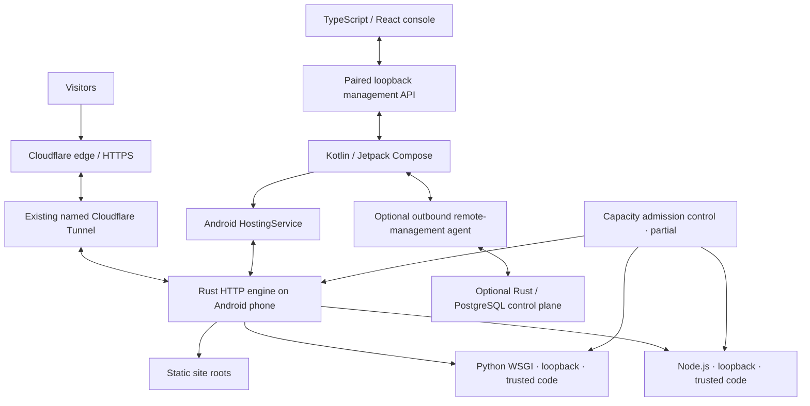

<!-- POCKETHOST · DESIGNED BY ASSAYFLUX -->
<p align="center">
  
</p>
<p align="center"><strong>Your website. Your device. Your control.</strong><br><sub>Designed by AssayFlux · Native Android hosting without Termux or root</sub></p>

<p align="center">
  <a href="https://github.com/AssayFlux/PocketHost/blob/main/LICENSE"></a>
  <a href="https://github.com/AssayFlux/PocketHost/actions/workflows/quality.yml"></a>
  <a href="https://github.com/AssayFlux/PocketHost/actions/workflows/android-integration.yml"></a>
</p>

**AssayFlux Pocket Host** turns a compatible Android phone into a compact website origin. The phone hosts the website; Rust owns HTTP serving and routing; Kotlin manages Android lifecycle and native controls; TypeScript powers the management console. Optional Python and Node.js runtimes execute trusted application code. Cloudflare Tunnel provides outbound connectivity. An optional remote control plane manages devices but never replaces the phone as the website origin.

> **Status: integrated development build — not production approved.** The Android app now has Dashboard, Sites, Files, Activity, Learn and Settings navigation with the classic navy theme, while the TypeScript console and Dashboard include a device-specific static-workload Capacity Lab, calibrated connection-admission budget, temporary capacity schedules, explicit HTTP 503 overload rejection and daily aggregate operations reports. These are bounded first implementations, not a complete adaptive governor or a universal capacity guarantee. The current Android source and Android-test source compile in [Quality CI run 43693751852](https://github.com/AssayFlux/PocketHost/actions/runs/43693751852); responsive screenshot/device acceptance, physical-device, public-domain, runtime-isolation and independent security gates remain. See [current status](docs/PHASE_0_STATUS.md).

## North Star

Make reliable, transparent and affordable self-hosting accessible to people with limited budgets or no need for large cloud services. PocketHost should make a phone's real capacity understandable, automatically protect it from overload, and keep the basic static website workflow simple.

- Phone is the website server; local hosting must not require a VPS.
- No Termux and no root.
- Android 8.0 / API 26+; target a 4 GB RAM baseline; ARMv7 and ARM64 phones.
- Static websites first; optional Python WSGI and Node.js for trusted code.
- Rust central engine; Kotlin Android app; TypeScript/React console.
- Simple and Advanced modes, extensive but safe customization.
- Existing user-owned domain and Cloudflare Tunnel must be reused, not recreated.
- Remote control plane is optional and separately deployed.

Read [North Star](docs/NORTH_STAR.md), [Roadmap](docs/ROADMAP.md), and [Development Context](docs/DEVELOPMENT_CONTEXT.md) before making architectural changes.

## Capacity and operations

- Collect versioned device telemetry: model/API/ABIs/CPU cores, sampled CPU load, RAM/PSS/heaps, storage, battery/temperature, thermal state and network transport.
- Run a bounded loopback static GET benchmark while hosting is active.
- Start with a conservative provisional ceiling of four connections until the first benchmark, then store a device/workload-specific safe concurrency ceiling and apply a 1–100% admission profile.
- Schedule a temporary 30% profile for three hours; expiry restores the previous profile.
- Automatically reduce the admission ceiling under high CPU load, critical memory/storage/thermal pressure and constrained battery conditions; suspend optional Python/Node runtimes in protective/emergency states while preserving static hosting.
- Reject excess connections with an explicit HTTP 503 and Retry-After response instead of silently dropping them.
- Archive daily aggregate traffic and redacted operational-event summaries with bounded 90-report retention.

The current benchmark covers the local static GET route only. It does not certify Python/Node workloads, external network/tunnel capacity, long-duration thermal sustainability, requests per second for arbitrary sites, or a visitor-count SLA. The full Rust-native thermal/memory/rate/fairness Resource Governor, OS-enforced runtime sandbox, payment processing and tamper-evident audit workstreams remain open.

## Architecture



The website request path and administration path are separate. The Cloudflare Public Hostname must point to the Rust website listener, never the local management API. Cloudflare Tunnel does not itself authenticate visitors; use Cloudflare Access for private sites.

## Technology responsibilities

| Layer | Technology | Responsibility |
|---|---|---|
| Android app | Kotlin, Jetpack Compose | UX, permissions, storage, lifecycle and notifications |
| Hosting engine | Rust, Tokio, Hyper | Static HTTP, hostname routing, reverse proxy, request limits and metrics |
| Native boundary | JNI | Coarse-grained Kotlin/Rust lifecycle and status |
| Python | CPython 3.11 via Chaquopy | One trusted WSGI app; preview feature |
| Node.js | Pinned Node 24 mobile SDK | One trusted app in dedicated `:node` process |
| Console | TypeScript, React, Vite | Local device management |
| Connectivity | Android-targeted cloudflared | Outbound Cloudflare connection |
| Remote management | Rust/Axum + PostgreSQL | Optional device registry, commands, roles and audit |

## Source capability snapshot

| Area | Current source status | Limitation / evidence still needed |
|---|---|---|
| Static hosting | Integrated Rust engine; GET/HEAD, streaming, ranges, MIME and path checks | Physical performance, security and external-domain acceptance |
| Multi-site | Host registry and static/Python/Node routing | End-to-end conflict and isolation tests |
| Python | CPython 3.11 WSGI preview runtime | Trusted code only; no strong sandbox or hard CPU/RAM quotas |
| Node.js | Node 24.22.1 mobile SDK, JNI and dedicated process | Trusted code only; process boundary is not a security sandbox |
| Local management | Loopback API, pairing and expiring sessions | Full endpoint abuse/security validation |
| Console | TypeScript/React connected to local API | Browser-origin and device end-to-end tests |
| Cloudflare | Android connector build, encrypted token and reconnect supervision | Reuse configured tunnel; verify public HTTPS from another network |
| Backup | Encrypted static-site backup | Does not yet cover all runtime/configuration/payment data |
| Remote management | Optional backend and phone agent source | Not deployed or real-device verified merely by existing source |
| Adaptive capacity | Partial implementation: versioned device telemetry, static GET Capacity Lab, 1–100% timed profiles, Rust concurrency admission cap, five-state device health derating and protective runtime suspension | Broader workload calibration, full Rust rate/fairness/queue governor, long-duration validation and recovery acceptance remain |
| Daily reports | Partial implementation: aggregate traffic and redacted operational-event snapshots, 90-report retention and JSON export | Full uptime, latency, tunnel, financial reconciliation and durable backup coverage remain |
| Payment ledger | Security requirements specified in PR #14 | No live payment-processing or PCI-compliance claim |
| Audit integrity | Conventional append-only hash-chained records and signed checkpoints are specified | Audit implementation and independent verification remain open |

## Adaptive capacity: intended product behavior

PocketHost will detect hardware and live device health, benchmark realistic workloads, and calculate a conservative **sustainable safe capacity**. It will display measured throughput/latency/concurrency graphs and distinguish observed peak from safe operating capacity.

A Resource Governor will reduce admission, bound queues, throttle expensive routes, return controlled 429/503 responses and recover gradually as the phone cools or memory returns. Owners will be able to schedule profiles such as **30% of calibrated safe capacity for 3 hours**. This is a share of measured safe budget, not a claim of 30% CPU usage or a guaranteed visitor count.

Full requirements and acceptance criteria: [Adaptive Capacity, Security, Payments and Operations](docs/ADAPTIVE_CAPACITY_SECURITY_OPERATIONS.md).

## Security and payments

Security must be designed into each boundary. Python and Node currently execute with PocketHost's app UID; neither is a hostile-code sandbox. A local trusted-code acknowledgement gate now blocks accidental runtime starts and removes optional public routes when revoked, but this is not isolation. Strong project isolation, filesystem/network restrictions and OS-enforced resource limits are release-blocking before accepting untrusted workloads.

For payments, integrate a reputable payment service provider using hosted/tokenized checkout and signed, replay-resistant webhooks. Store provider transaction references and an encrypted durable event ledger, never raw card numbers or CVVs. Use conventional append-only hash-chained audit records and signed checkpoints. Do not claim PCI compliance without qualified assessment.

## Product constraints

A phone is not a cloud region. Battery, heat, Android Doze/OEM process management, memory, storage, carrier NAT, mobile data caps and network outages affect availability. PocketHost must never promise unlimited traffic or guaranteed 24/7 uptime. Capacity is workload-specific and must be measured on the actual device.

## UI design

The canonical screen, navigation, responsive-layout, keyboard and implementation specification for **AssayFlux Pocket Host** is [UI Design](docs/UI_DESIGN.md). The in-app beginner guides are documented in [Learn and Quick Start](docs/LEARN_GUIDE.md). Host Owner/Operator authentication and permission boundaries are documented in [UI Design](docs/UI_DESIGN.md).

## Documentation map

| Document | Why it exists |
|---|---|
| [North Star](docs/NORTH_STAR.md) | Product vision, principles, non-goals and decision filter |
| [Roadmap](docs/ROADMAP.md) | Sequenced product work, priorities and release gates |
| [Master Plan](docs/MASTER_PLAN.md) | System architecture, module contracts and technical design |
| [Development Context](docs/DEVELOPMENT_CONTEXT.md) | Canonical handoff and rules for every future contributor/assistant |
| [Architecture Decisions](docs/DECISIONS.md) | Accepted decisions and change-control process |
| [Implementation Status](docs/PHASE_0_STATUS.md) | Commit-specific source and validation evidence |
| [Completion Milestone](docs/COMPLETION_MILESTONE.md) | Definition of done and release checklist |
| [Adaptive Capacity & Security](docs/ADAPTIVE_CAPACITY_SECURITY_OPERATIONS.md) | Hardware intelligence, governor, payments, audit and logs |
| [Python Runtime](docs/PYTHON_RUNTIME.md) | WSGI contract and security limitations |
| [Node Runtime](docs/NODE_RUNTIME.md) | SDK provenance, runtime contract and limitations |
| [Cloudflare Tunnel](docs/CLOUDFLARE_TUNNEL.md) | Reuse and verify the existing tunnel |
| [Remote Control Acceptance](docs/REMOTE_CONTROL_ACCEPTANCE.md) | Device, backend and external acceptance |
| [Control-plane Deployment](docs/CONTROL_PLANE_DEPLOYMENT.md) | Optional management backend deployment |
| [Release Signing](docs/RELEASE_SIGNING.md) | Signed APK release process |

## Build overview

Build prerequisites: JDK 17, Android SDK 35, NDK 27.2.12479018, CMake 3.22.1, Rust stable with Android targets, cargo-ndk, Go 1.27.4 for cloudflared and Node.js/npm for the console. The pinned Node mobile SDK is retrieved during native builds.

Compile Android sources without APK packaging:

```bash
gradle :app:externalNativeBuildDebug :app:compileDebugKotlin :app:compileDebugAndroidTestKotlin
```

Use the [Android integration workflow](.github/workflows/android-integration.yml) for ABI APK assembly and emulator instrumentation. See [release signing](docs/RELEASE_SIGNING.md) before producing release APKs.

## Security disclosure

Never expose the local management API publicly. Never import untrusted code under the current runtime model. Do not place tunnel/payment/control-plane tokens, signing keys or database credentials in website roots, source control or logs. Review diagnostic exports before sharing.

## License

See [LICENSE](LICENSE) and third-party notices under `app/src/main/assets/licenses/`.


## Current repository evidence snapshot — 2026-11-15

This snapshot is anchored to main commit `671f3f731f4bf093449a95e285327115f41bb75b`. Re-check the linked workflow runs before using this document as a release approval; statuses can change after this snapshot.

### Merged implementation

- PR [#16 — interactive Learn section and card-first navigation](https://github.com/AssayFlux/PocketHost/pull/16) is merged. The app/console include the Learn experience and an initial measured-capacity visualization. The chart is based on recorded static benchmark samples; it is not synthetic live telemetry.
- PR [#17 — Owner and Operator host accounts](https://github.com/AssayFlux/PocketHost/pull/17) is merged. The source includes an encrypted app-private account registry, password verifiers, Owner/Operator authorization, account revocation and console sign-in/bootstrap flows. The PR describes instrumentation coverage, but this snapshot does not assert that the latest main-branch emulator workflow has passed.
- The app has a Learn destination and documentation at [LEARN_GUIDE.md](LEARN_GUIDE.md). The UI remains an initial implementation requiring responsive and device acceptance.

### Exact CI evidence at review time

- Main commit: `671f3f731f4bf093449a95e285327115f41bb75b`.
- [Quality workflow 43699334752](https://github.com/AssayFlux/PocketHost/actions/runs/43699334752): completed successfully. Its six source-quality jobs include Rust, control plane, Python, Node, TypeScript console and Android source compilation.
- [Android integration workflow 43699334785](https://github.com/AssayFlux/PocketHost/actions/runs/43699334785): pending when inspected. Do not infer APK assembly or emulator instrumentation success from the quality workflow.

### Remaining release gates — not completed by these merges

1. **Android acceptance:** finish integration workflow; verify APK packaging/signatures/ABI contents; pass API 26/33/35 instrumentation on the exact release SHA; test real ARMv7/ARM64 phones, foreground service, Doze, reboot, battery/thermal behavior, keyboard, accessibility, landscape and responsive layouts.
2. **Native authentication polish:** Android BiometricPrompt/Keystore unlock, secure Owner recovery, complete native login/logout/expired/revoked-session UX and end-to-end instrumentation remain unverified or incomplete. Console sign-in and API role enforcement do not by themselves prove native biometric login.
3. **Runtime isolation:** Python and Node execute under the Pocket Host app UID. The Node process and V8 heap limit are not a sandbox. Keep optional runtimes restricted to trusted code until OS-enforced filesystem/network isolation and enforceable resource quotas pass adversarial review.
4. **Cloudflare:** configure/reuse the owner's existing named tunnel on a physical device and verify the Public Hostname serves the intended site over HTTPS from an external network. The public hostname must never target the loopback management API.
5. **Capacity:** current benchmark and admission controls are first implementations. Complete representative cached/uncached and payload-size workloads, Python/Node trusted workload measurements, throughput and p50/p95/p99, Rust-native rate/fairness/bounded-queue controls, graceful drain, long-duration thermal tests and schedule restart/expiry acceptance.
6. **Operations:** extend backup beyond static-site scope; test restore and interruption; complete request-level redacted logs, durable/tamper-evident audit verification, storage-pressure behavior and reproducible daily reports.
7. **Optional remote management:** deploy the control plane on a trusted host, pair the real phone, then test desired configuration, leased commands, acknowledgements, revocation and recovery. Source code alone is not deployment evidence.
8. **Payments:** no live payment processing is implemented/approved. If enabled for launch, select a PSP and implement hosted/tokenized checkout, signed/replay-protected webhooks, idempotent durable ledger, reconciliation, encrypted backups and qualified security review. Never store PAN/CVV/PIN.
9. **Release:** configure production signing, verify upgrade paths and checksums, review dependencies/secrets and resolve all critical/high security findings.

### Product boundaries

- Static hosting remains the primary independent feature; optional runtimes, payments and remote management must not be prerequisites.
- Android foreground services improve continuity but cannot guarantee 24/7 uptime or override OEM/OS battery policies.
- Cloudflare Tunnel connectivity is not visitor authentication; use Cloudflare Access for private sites.
- Do not claim universal visitor counts, complete sandboxing, payment compliance, deployed remote control, production readiness or a signed release without the corresponding evidence.
- Blockchain technology remains excluded from the product and codebase. Conventional local audit integrity, if implemented, is not blockchain.

**Release decision:** integrated development build; not production approved. This status changes only when the relevant code, tests, device/network evidence and security review are recorded against the exact release commit.
