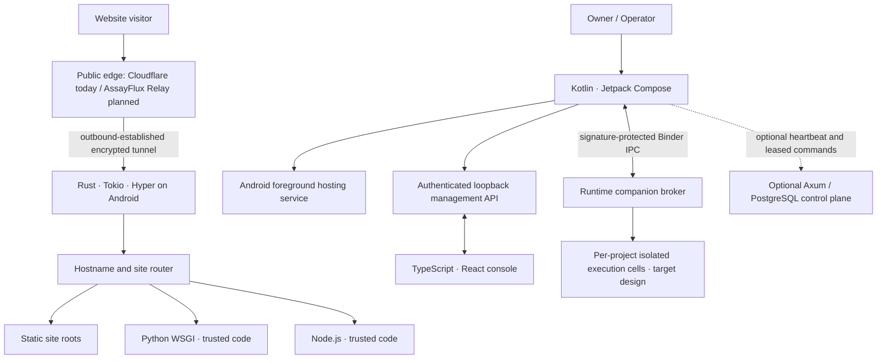

<!-- ASSAYFLUX · POCKET HOST -->
<p align="center">
  
</p>
<h1 align="center">ASSAYFLUX POCKET HOST</h1>
<p align="center"><strong>Your website. Your device. Your control.</strong></p>
<p align="center">Turn an Android phone into a self-hosted website origin — without root, Termux or a mandatory cloud server.</p>

<p align="center">
  
  
  
  
  
  
</p>
<p align="center">
  
  
  
</p>

---

## 01 · PROJECT OVERVIEW

AssayFlux Pocket Host makes an Android phone the origin server for websites and small web applications. The phone runs the website engine; optional edge connectivity makes it reachable from the internet. The app is designed for budget-conscious owners, independent developers and operators who want understandable hosting controls on hardware they already own.

**Core promise:** Import → Validate → Preview → Publish → Observe → Protect → Recover.

**Product identity**
| Property | Value |
|---|---|
| Application | AssayFlux Pocket Host |
| Developer | Designed by AssayFlux |
| Android package | `com.assayflux.pockethost` |
| Runtime companion | `com.assayflux.pockethost.worker` |
| Minimum Android | Android 8.0 · API 26 |
| Device target | ARMv7 / ARM64; x86_64 for emulator coverage |
| Operating model | Native Android; no root; no Termux |
| Release position | Pre-release engineering; not production approved |

The phone remains the website origin. A VPS is not required for local hosting. Public access can use the owner's existing Cloudflare Tunnel; a first-party AssayFlux Relay is now part of the product north star but is **planned, not yet implemented**.

## 02 · PRODUCT MODES

| Mode | Workflow | Intended capabilities |
|---|---|---|
| **Simple** | Import a static site, preview, publish and monitor | Static website hosting, hostname setup, connection status, backup and restore |
| **Advanced** | Operate multiple sites and trusted application backends | Host routing, Python WSGI, Node.js, resource budgets, Capacity Lab, diagnostics and optional remote management |

Static hosting is the dependable foundation. Python, Node, public tunnels and remote management must remain optional. Pocket Host targets modest websites and workloads; it is not an unlimited cloud-region replacement or uptime guarantee.

## 03 · TECHNOLOGY ECOSYSTEM

<p align="center">
  
  
  
  
</p>
<p align="center">
  
  
  
  
</p>
<p align="center">
  
  
  
</p>
<p align="center">
  
  
  
  
  
</p>

| Technology | Responsibility |
|---|---|
| Kotlin + Jetpack Compose | Android UI, lifecycle, permissions, storage access and device telemetry |
| Rust + Tokio + Hyper | HTTP ingress, static files, hostname routing, reverse proxy, bounded admission and engine metrics |
| C++ / JNI | Native Node bridge and coarse-grained host-engine integration |
| CPython 3.11 / Chaquopy | Embedded Python WSGI runtime, currently companion-UID trusted-code scope |
| Node.js mobile 24.22.1 | Embedded Node runtime, currently companion-UID trusted-code scope |
| TypeScript + React + Vite | Browser management console |
| Axum + SQLx + PostgreSQL | Optional remote management control plane |
| cloudflared | Existing Cloudflare outbound tunnel connector |
| Android Keystore / AES-GCM | Device-bound secret protection and encrypted backups |

Technology icons describe the repository's stack, not proof that every subsystem has passed release acceptance.

## 04 · SYSTEM ARCHITECTURE



**Responsibility boundaries**
- Rust is the website request engine and only intended public ingress.
- Kotlin owns Android lifecycle and device integration.
- The management API is separate, authenticated and loopback-only; never route a public hostname to it.
- The companion is a separate Android package/UID from the host. It does **not** yet isolate projects from one another.
- The AssayFlux Relay gateway and isolated runtime cells are planned architecture, not current shipped capability.

## 05 · REQUEST AND CONTROL FLOWS

**Website request**
1. A visitor requests a configured hostname.
2. The selected public connector forwards traffic to the phone's Rust listener.
3. Rust validates the host and selects the registered site.
4. Static content is served directly, or Rust proxies to the configured trusted runtime.
5. The response returns through the same connector.

**Local administration**
1. Owner opens Pocket Host or the local console.
2. Browser pairing requires an approval challenge in the Android app.
3. An expiring session authorizes the permitted management routes.
4. Session revocation and service restart invalidate access as specified by the API.

**Optional remote management**
1. Phone agent establishes outbound authenticated communication with the control plane.
2. Control plane stores device registration, heartbeat, roles and leased commands.
3. Device validates command scope, expiry and replay state before execution.
4. Website traffic still terminates at the phone's Rust engine; the control plane does not serve the site.

## 06 · IMPLEMENTED FOUNDATIONS AND OPEN GATES

| Area | Source-level foundation | Evidence still required |
|---|---|---|
| Android app | Kotlin/Compose, five destinations, foreground hosting service | Exact-head emulator and physical-device acceptance |
| Rust engine | Tokio async runtime, Hyper HTTP, static serving, routing, proxy and bounded admission | Fairness, fault injection and sustained-load evidence |
| Python | CPython 3.11 / WSGI moved to companion package | Companion build, end-to-end routing and per-project isolation |
| Node | Node 24.22.1 mobile native runtime moved to companion | ABI/runtime proof, end-to-end routing and per-project isolation |
| Companion IPC | Signature permission, caller validation, protocol versioning and bounded archive transfer | API 26/33/35 lifecycle and security acceptance |
| Isolation | Native seccomp/isolated-UID proof code exists | Probe success, production Python/Node migration and adversarial review |
| Console | TypeScript/React/Vite management UI | Responsive, accessibility and visual acceptance |
| Cloudflare | Android cloudflared build integration; owner already has a tunnel | Verify existing named tunnel and external HTTPS against Rust origin |
| AssayFlux Relay | Product architecture defined in North Star | Gateway, agent, stream transport, enrollment, auth and operations are not implemented |
| Capacity | Telemetry, initial static Capacity Lab and admission controls | Full governor, runtime profiles, percentile and thermal evidence |
| Backup | Encrypted .afbackup format and staged restore foundation | Corruption, interruption, low-storage and rollback fault matrix |
| Control plane | Axum/PostgreSQL source and deployment workflow | Actual deployment, device pairing and end-to-end remote-command evidence |
| Release | Debug packaging workflow | Signed host/companion release, checksums, upgrades and independent review |

**Security warning:** Python and Node are currently trusted owner-controlled code only. A separate companion UID protects host-private data better than in-process execution, but all projects still share the companion UID and outbound egress is not OS-enforced. Do not run hostile or visitor-submitted code. Gate 2 is open.

## 07 · NETWORKING OPTIONS — PRODUCT TARGET

| Option | Purpose | Position |
|---|---|---|
| AssayFlux Relay | First-party outbound private tunnel; visitor connects to relay, phone maintains outbound encrypted session | **Planned** |
| Cloudflare Tunnel | Reuse existing named tunnel and domain; Public Hostname targets Rust listener | Existing integration; external verification required |
| Local network | Serve on trusted LAN without public exposure | Existing local-hosting path; device/network acceptance required |
| Direct hosting | Owner-managed public ingress, firewall and TLS | Advanced future option; not a recommended default |

AssayFlux Relay must hide the phone's public IP from ordinary visitors, not from the relay operator or network provider. It needs mutual device authentication, revocation, hostname authorization, rate limits, TLS, bounded streams and clear relay privacy disclosure. Visitor authentication must be separate from Owner/Operator management authentication. The relay must never expose the management API.

## 08 · STEP-BY-STEP: PUBLISH A STATIC WEBSITE

1. **Prepare the website.** Build your site with its normal toolchain. Pocket Host serves deployment output; it does not run your desktop build process.
2. **Find the output folder.** Examples: Vite `dist/`, static Next.js export `out/`, or the framework's production output. Confirm a root `index.html` exists.
3. **Import.** Open Pocket Host → Sites → choose a website folder or import a ZIP.
4. **Validate.** Check the site manifest, file sizes, paths and entry page. Do not activate an invalid archive.
5. **Preview.** Test the site locally before publication.
6. **Configure hostname.** Add the hostname that should map to this site. Avoid duplicate or malformed hostnames.
7. **Choose connectivity.** For the existing setup, reuse the already configured Cloudflare Tunnel. The planned AssayFlux Relay will be another option when implemented.
8. **Point the edge to Rust.** Cloudflare Public Hostname must target the Rust website listener, never the management API.
9. **Publish and verify.** Start hosting and request the hostname from a separate network. A local connector status is not proof of external HTTPS.
10. **Protect and recover.** Create an encrypted backup, review logs and use staged update/rollback for future deployments.

## 09 · STEP-BY-STEP: PYTHON AND NODE APPLICATIONS

These are advanced, trusted-code workflows; do not deploy arbitrary third-party code.

**Python WSGI**
1. Prepare a root `wsgi.py` exporting callable `application(environ, start_response)`.
2. Bundle supported dependencies before import; Pocket Host does not automatically run pip.
3. Import the project through Sites → Python.
4. Review the trust acknowledgement and start the worker.
5. Confirm Rust routes the configured hostname to the loopback WSGI upstream.
6. Inspect lifecycle and logs; test stop/restart and static-site continuity.

**Node.js**
1. Prepare a self-contained project with `package.json` and a resolvable server entry.
2. Include prebundled dependencies; on-device `npm install`, PM2 and arbitrary child-process workflows are not supported.
3. Import through Sites → Node.
4. Review the trust acknowledgement and start the worker.
5. Confirm Rust proxies requests to the Node loopback listener.
6. Verify memory, shutdown and restart behaviour.

**Current security limitation:** Python and Node share the companion UID and do not have OS-enforced per-project egress denial. Runtime hosting remains owner-trusted-code-only until Gate 2 is implemented and independently verified.

## 10 · DEVICE CAPACITY AND PROTECTION

Capacity depends on response size, route mix, caching, tunnel overhead, network, memory pressure and thermal state. Do not publish a universal visitor count.

Pocket Host's direction is to measure:
- Observed peak throughput in a named test.
- Sustainable safe concurrency/throughput within latency, memory and thermal limits.
- Current configured admission budget after health derating.

The first Capacity Lab and health-based admission derating are foundations. Fair per-site scheduling, representative Python/Node profiles, p50/p95/p99, long-duration load, energy and recovery evidence remain open. Android may stop processes; the app cannot promise to override OEM power management.

## 11 · BACKUP, OPERATIONS AND RECOVERY

The encrypted `.afbackup` format protects supported site data and selected non-secret settings. Device-bound credentials, account sessions, Cloudflare tokens and Keystore keys are excluded and must be configured again on a replacement device. Python/Node projects are executable source; protect backup files and passphrases separately.

Before production, fault-test corrupted archives, wrong passphrases, interruption, low storage, failed activation, rollback and secret exclusion. Logs must be bounded and redact tokens, passwords, session values and sensitive headers.

## 12 · BUILD FROM SOURCE

**Prerequisites**
- Android Studio or compatible Gradle environment.
- Repository Gradle wrapper and the Android SDK/NDK versions declared by the project.
- JDK version required by the Gradle/Android Gradle Plugin configuration.
- Rust toolchain and Android targets required by the native build.
- Network access for pinned dependencies and native runtime archives.

**Inspect project configuration first**
1. Read `gradle/libs.versions.toml`, root Gradle files and module build files.
2. Read `local.properties.example` if present; create local SDK configuration without committing machine-specific paths.
3. Review `.github/workflows/quality.yml` and `.github/workflows/android-integration.yml` for authoritative CI tasks.
4. Do not invent SDK, NDK, Rust or JDK versions; use the pinned repository configuration.

**Build**
```bash
git clone https://github.com/AssayFlux/PocketHost.git
cd PocketHost
git checkout main
./gradlew tasks
./gradlew assembleDebug
```

The repository contains separate host and runtime companion Android modules. Confirm the exact APK output paths from Gradle task output; do not assume a single APK is sufficient. ABI-specific native dependencies must match the target device. CI builds are the reproducible reference; a successful local compile is not device acceptance.

## 13 · CI, TESTING AND RELEASE EVIDENCE

Quality CI covers language-specific checks, native engine tests, control-plane checks, console build and Android source compilation. Android integration separately builds native Cloudflare dependencies, packages Android variants and runs emulator API levels.

A release record must identify:
- Exact commit SHA and workflow run.
- Host and companion APKs, ABI and package IDs.
- API level, test count, failures and skipped tests.
- Artifact integrity, signing certificate and SHA-256 checksums.
- External hostname/TLS test and physical-device test evidence.

Never treat a queued workflow as a pass, compilation as runtime proof, an emulator as a physical phone, or a source file as a completed feature.

## 14 · REPOSITORY MAP

| Path | Purpose |
|---|---|
| `app/` | Main Android host app, UI, lifecycle, management and Rust integration |
| `runtime-worker/` | Companion Android package, CPython/Node integration and isolation probes |
| `rust-engine/` | Tokio/Hyper website engine and JNI-facing native core |
| `console/` | TypeScript/React/Vite management console |
| `control-plane/` | Optional Axum/PostgreSQL remote-management service |
| `scripts/` | Native dependency and build helpers |
| `.github/workflows/` | Quality, Android integration, deployment and release workflows |
| `docs/` | North Star, architecture, security, operations and release specifications |
| `examples/` | Starter website/runtime projects |

## 15 · DOCUMENTATION GUIDE

Read these in order; paths are intentionally shown as plain text for easy copying.

1. `docs/NORTH_STAR.md` — product vision, principles and complete primary-version sequence.
2. `docs/DEVELOPMENT_CONTEXT.md` — mandatory engineering handoff and constraints.
3. `docs/PROJECT_BASELINE.md` — evidence-based scope and readiness method.
4. `docs/ROADMAP.md` — ordered release gates and exit criteria.
5. `docs/MASTER_PLAN.md` — architecture and implementation contracts.
6. `docs/DECISIONS.md` — accepted architecture decisions.
7. `docs/INDEX.md` — full documentation catalogue.
8. `docs/SECURITY_GATE_2_EXECUTION_PLAN.md` and `docs/SECURITY_ISOLATION_DESIGN.md` — runtime isolation.
9. `docs/CLOUDFLARE_TUNNEL.md` — existing tunnel setup.
10. `docs/ADAPTIVE_CAPACITY_SECURITY_OPERATIONS.md` — capacity and operational protection.
11. `docs/SITE_BACKUP.md` — encrypted backup and restore.
12. `docs/RELEASE_SIGNING.md` — production signing and artifact acceptance.

## 16 · RELEASE POSITION

Pocket Host remains pre-release. Companion source migration and isolation proof work are not equivalent to verified production runtime isolation. AssayFlux Relay is a planned first-party service and must not be represented as available. Complete the ordered North Star gates, pass API 26/33/35 on one exact source SHA, validate real devices and public connectivity, and obtain independent security review before production approval.

**Designed by AssayFlux · AssayFlux Scientific Systems**
